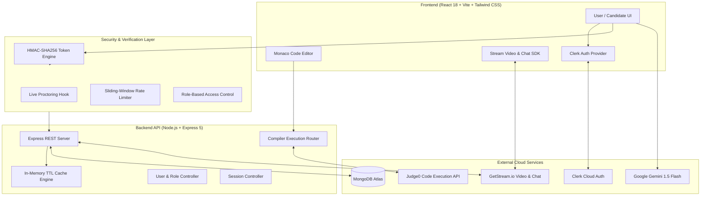

<p align="center">
  
</p>

<h1 align="center">⚡ Evalify ⚡</h1>

<p align="center">
  <strong>Next-Generation AI Technical Interview, Live Proctoring & Collaborative Coding Platform</strong>
</p>

<p align="center">
  
  
  
  
  
  
  
  
  
  
</p>

---

## 📖 Overview

**Evalify** is a comprehensive, production-grade technical assessment platform designed for engineering teams and candidates. It bridges modern AI evaluation with real-time video collaboration, live anti-cheat proctoring, multi-language sandbox code execution, and enterprise role-based access control.

Whether conducting live 1-on-1 peer technical rounds, simulating AI-driven interviews across FAANG question sets, or analyzing candidates' resumes for ATS fit, Evalify provides an end-to-end suite for hiring and interview prep.

---

## ✨ Key Features & Portals

### 👔 1. Interviewer Portal (`/interviewer-portal`)
- **Interview Scheduling**: Create interviews with custom titles, roles, durations, dates, and times.
- **Candidate Selection & Contact Management**: Select from preloaded candidates or add custom candidates. Easily update candidate phone numbers and email addresses on the fly.
- **Custom Question & Problem Assignment**: Add tailored technical/system design questions and assign LeetCode-style algorithmic coding problems.
- **Configurable AI Evaluation**: Customize rubric weights across *Code Correctness*, *Problem Solving*, *System Design*, and *Communication* with adjustable strictness modes.
- **Anti-Cheat Enforcement Controls**: Configure proctoring parameters (tab-switch limits, webcam enforcement, audio monitoring, copy/paste disabling, full-screen lockdown).
- **Live Interview Monitoring**: Monitor live candidates in real time with active violation counters, code editor snapshots, and instant performance metrics.
- **One-Click Secure Dispatch**: Send encrypted invitations directly to candidates via **WhatsApp** (`wa.me`) or **Email** (`mailto:`) with pre-composed professional templates.

### 🎓 2. Interviewee / Candidate Portal (`/interviewee-portal`)
- **Time-Locked Room Access**: Enforces scheduled window integrity. Rooms unlock exactly within the permitted schedule (with a 15-minute preparation buffer) and lock automatically once expired.
- **Encrypted Token Authentication**: Only the candidate whose Clerk credentials match the cryptographically signed URL token can access the room.
- **Interactive Coding Workspace**: Full-screen IDE powered by the Monaco Editor with real-time compiler outputs and unit test verification.
- **Interview History & Performance Analytics**: Review past completed sessions, track historical scores, and download comprehensive PDF interview reports.

### 🎥 3. Real-Time Collaborative 1-on-1 Interview Rooms (`/session/:id`)
- **HD Video & Audio**: Powered by GetStream Video SDK with camera toggles, microphone controls, and screen sharing.
- **Synchronized Chat**: Built-in messaging channel for sharing links, hints, and notes.
- **Multi-Language Monaco Code Editor**: Syntax highlighting, auto-formatting, bracket pairing, and multiple theme options.
- **Multi-Engine Execution**: Executes code across Python, JavaScript, Java, C++, Go, Rust, and more via Judge0 REST API with automatic local sandbox fallback.
- **Live Room Locking**: Automatically restricts room capacity to the host and verified participant.

### 🤖 4. AI-Powered Interview Hub & Session (`/ai-interview`)
- **Conversational AI Interviewer**: Driven by Google Gemini 1.5 Flash with speech-to-text / voice response capabilities.
- **7-Dimension Scoring Engine**:
  1. *Code Correctness*
  2. *Communication Clarity*
  3. *Technical Accuracy*
  4. *Confidence & Delivery*
  5. *Completeness*
  6. *Logical Reasoning*
  7. *Problem-Solving Methodology*
- **Instant Detailed Report**: Generates hiring recommendations (*Strong Hire*, *Hire*, *Borderline*, *No Hire*) with actionable feedback and downloadable PDF export.

### 🛡️ 5. Anti-Cheating & Proctoring Engine
- **Tab & Window Blur Tracking**: Detects when candidates switch tabs or minimize the browser.
- **Fullscreen Lockdown**: Warns and logs incidents if fullscreen mode is exited.
- **Hardware Monitoring**: Ensures webcam and microphone remain active throughout the session.
- **Clipboard & DevTools Blocking**: Disables copy/paste into the editor and blocks inspection shortcuts (F12, Ctrl+Shift+I).

### 📄 6. ATS Resume Analyzer (`/resume-analyzer`)
- **Multi-Format Parsing**: Upload resumes in PDF, DOCX, or TXT format.
- **Job Role Match Scoring**: Evaluates resume compatibility against target technical roles.
- **Actionable Gap Analysis**: Identifies missing core competencies, keyword optimization recommendations, and formatting advice.

### 🏢 7. Top-Tier Company Preparation (`/company-prep`)
- Targeted practice modules modeled after FAANG and top tech companies (Google, Amazon, Meta, Microsoft).
- Includes company-specific behavioral, algorithmic, and system design question banks.

---

## 🏗️ System Architecture & Data Flow



---

## 📂 Project Directory Structure

```plaintext
Evalify/
├── backend/
│   ├── src/
│   │   ├── controllers/         # REST API business logic (users, sessions, problems)
│   │   ├── lib/                 # Core utilities (cache.js, db.js, env.js, inngest.js, stream.js)
│   │   ├── middleware/          # Security middlewares (rateLimiter, jwtAuth, authorizeRole, auditLog)
│   │   ├── models/              # Mongoose database schemas (User, Session, Problem, Interview)
│   │   ├── routes/              # Express API routers (userRoutes, sessionRoute, pistonRoutes, chatRoutes)
│   │   └── server.js            # Main backend entry point, static asset serving & health check
│   ├── package.json             # Backend dependencies and scripts
│   └── .env.example             # Backend environment variables reference
├── frontend/
│   ├── public/                  # Static brand assets and icons
│   ├── src/
│   │   ├── api/                 # Axios API request clients
│   │   ├── components/          # Reusable UI components (Navbar, Modals, ProtectedRoute)
│   │   ├── data/                # Coding problem bank, company questions, AI prompts
│   │   ├── hooks/               # Custom React hooks (useAntiCheating, useLocalStorage)
│   │   ├── lib/                 # Client utilities (aiEvaluator, secureInviteToken, solvedStorage)
│   │   ├── pages/               # Lazy-loaded page components (20+ routes)
│   │   ├── App.jsx              # React Router setup with Suspense fallbacks
│   │   └── main.jsx             # React DOM root with Clerk and Query Client providers
│   ├── package.json             # Frontend dependencies and Vite configuration
│   └── vite.config.js           # Vite build optimization, manual vendor chunks, and proxy
├── scripts/
│   └── test-phase8.js           # Automated regression test suite (cache, rate limiter, JWT, validator)
├── .dockerignore                # Container build context exclusions
├── .env.example                 # Unified root environment variable template
├── Dockerfile                   # Multi-stage production container build
├── package.json                 # Monorepo root scripts (dev, build, start, test)
└── render.yaml                  # One-click Render.com cloud deployment blueprint
```

---

## 🛠️ Tech Stack & Integrations

| Layer | Technologies |
| :--- | :--- |
| **Frontend Core** | React 18, Vite 7, React Router 6, TanStack Query 5 |
| **Styling & UI** | Tailwind CSS v4, DaisyUI 5, Lucide React Icons |
| **Code Editor** | Monaco Editor (`@monaco-editor/react`) |
| **Real-time Video & Chat** | GetStream.io Video React SDK & Stream Chat React |
| **Authentication** | Clerk Authentication (`@clerk/clerk-react`, `@clerk/express`) |
| **Backend Core** | Node.js (v20+), Express.js (v5), Mongoose (v8) |
| **Database** | MongoDB Atlas Cloud Database |
| **AI Assessment** | Google Gemini 1.5 Flash REST API |
| **Code Execution** | Judge0 API (Cloud) + Local Node/Python Subprocess Sandbox |
| **Reporting** | jsPDF, html2canvas, Canvas Confetti |
| **Security** | Sliding-Window Rate Limiting, Native HMAC-SHA256 JWT, RBAC Middleware |
| **DevOps** | Docker (Multi-stage), Render Blueprint (`render.yaml`) |

---

## 📋 Prerequisites

Before running the project, make sure you have the following installed:

1. **Node.js**: v18.x or v20.x or higher (`node -v`)
2. **npm**: v9.x or higher (`npm -v`)
3. **MongoDB Atlas Account**: A free MongoDB Atlas cluster connection string.
4. **Clerk Account**: Free account at [clerk.com](https://clerk.com) (Publishable & Secret keys).
5. **GetStream.io Account**: Free account at [getstream.io](https://getstream.io) (API Key & Secret).
6. **Google Gemini API Key**: Free API key from [Google AI Studio](https://aistudio.google.com).

---

## 🚀 Step-by-Step Setup Guide

### 1. Clone the Repository
```bash
git clone https://github.com/your-username/evalify.git
cd evalify
```

### 2. Install Dependencies
You can install dependencies for both the root, backend, and frontend with a single command:
```bash
npm install
npm install --prefix backend
npm install --prefix frontend
```
*(Or run `npm run build:all` to install everything and build the frontend)*.

---

### 3. Configure Environment Variables

#### A. Backend Environment File (`backend/.env` or root `.env`)
Create a file at `backend/.env` (or copy `.env.example` to `backend/.env`):

```env
PORT=3000
NODE_ENV=development
CLIENT_URL=http://localhost:5173

# MongoDB Connection String (Atlas or Local)
DB_URL=mongodb+srv://<username>:<password>@cluster0.mongodb.net/evalify?retryWrites=true&w=majority

# Clerk Authentication Keys
CLERK_PUBLISHABLE_KEY=pk_test_...
CLERK_SECRET_KEY=sk_test_...

# GetStream Video & Chat Keys
STREAM_API_KEY=your_stream_api_key
STREAM_API_SECRET=your_stream_api_secret

# Inngest Background Jobs (Optional for local dev)
INNGEST_EVENT_KEY=your_inngest_event_key
INNGEST_SIGNING_KEY=your_inngest_signing_key

# JWT & Token Secret
JWT_SECRET=evalify_super_secret_jwt_key_2026
```

#### B. Frontend Environment File (`frontend/.env`)
Create a file at `frontend/.env`:

```env
# Clerk Publishable Key (Same as backend CLERK_PUBLISHABLE_KEY)
VITE_CLERK_PUBLISHABLE_KEY=pk_test_...

# Backend API URL (Leave as http://localhost:3000/api in dev; auto-resolves in production)
VITE_API_URL=http://localhost:3000/api

# GetStream API Key (Same as backend STREAM_API_KEY)
VITE_STREAM_API_KEY=your_stream_api_key

# Google Gemini API Key (For AI Interview Evaluation & Resume Analysis)
VITE_GEMINI_API_KEY=your_gemini_api_key_here
```

---

### 4. Run the Development Server

From the project root directory, run:
```bash
npm run dev
```

This starts both servers concurrently:
- 🚀 **Frontend UI**: [http://localhost:5173](http://localhost:5173)
- ⚙️ **Backend API**: [http://localhost:3000](http://localhost:3000)

---

### 5. Run the Automated Test Suite

Evalify includes an automated regression test suite covering caching, sliding-window rate limiting, native JWT validation, and request payload schema validators:

```bash
npm test
```

Expected output:
```plaintext
=========================================
 Evalify - Phase 8 Optimization Tests
=========================================
--- 1. Cache Engine Tests ---
  ✅ PASS: Cache correctly stores and retrieves objects
  ✅ PASS: Cache deletion correctly removes items
  ✅ PASS: Cache statistics are recorded properly

--- 2. Rate Limiter Middleware Tests ---
  ✅ PASS: First request passes with decrement remaining
  ✅ PASS: Second request passes with 0 remaining
  ✅ PASS: Third request exceeded limit and received 429

--- 3. Native JWT Security Tests ---
  ✅ PASS: Valid JWT verified successfully
  ✅ PASS: Tampered JWT rejected with error

--- 4. Request Validation Tests ---
  ✅ PASS: Invalid payload correctly rejected with status 400
  ✅ PASS: Valid payload correctly accepted

=========================================
 Results: 10 passed, 0 failed
=========================================
```

---

## 👥 How to Use & Access Portals

### Role-Based Access Flow
When signing up or logging in, Evalify provides dedicated portals based on user role:

1. **Select Role**: Go to `/select-role` and choose your persona:
   - **Candidate (Interviewee)**: Access assigned coding interviews, practice problems, AI mock sessions, and track streaks.
   - **Interviewer**: Access interview creation, candidate scheduling, custom questions, anti-cheat config, and live candidate monitoring.
   - **Admin**: Full administrative dashboard with platform-wide statistics.
2. **Interview Scheduling Flow**:
   - Open `/interviewer-portal` -> Click **"Schedule Interview"**.
   - Select a candidate, set date/time, pick questions, and toggle anti-cheat settings.
   - Click **"Send Invite"** -> Modal generates an encrypted, time-restricted invite token.
   - Click **"WhatsApp"** or **"Send Email"** to dispatch the invitation directly.
3. **Joining as a Candidate**:
   - The candidate opens the secure invitation link (`https://.../room/<id>?invite=<token>`).
   - The token verifies candidate identity against their logged-in Clerk account and ensures the scheduled interview time window is open.
   - The candidate enters the live room, codes in the Monaco IDE, tests their solution, and completes the interview.

---

## 📡 REST API Reference

| Method | Endpoint | Description | Auth Required |
| :--- | :--- | :--- | :--- |
| `GET` | `/health` | Server health status & cache diagnostics | No |
| `GET` | `/api/users/me` | Fetch authenticated user profile & role | Yes (Clerk) |
| `POST` | `/api/users/register` | Register new user & lock role in DB | Yes (Clerk) |
| `GET` | `/api/problems` | Fetch all coding problems (Cached 60s) | No |
| `GET` | `/api/problems/:id` | Fetch problem details by ID (Cached 120s) | No |
| `POST` | `/api/sessions` | Create a 1-on-1 collaborative session | Yes |
| `GET` | `/api/sessions/active`| Get all active live interview rooms | Yes |
| `GET` | `/api/sessions/:id` | Get details of a specific session | Yes |
| `POST` | `/api/sessions/:id/join` | Join session as participant | Yes |
| `POST` | `/api/sessions/:id/end` | Terminate session (Host only) | Yes |
| `POST` | `/api/piston/execute` | Multi-language code execution engine | No |

---

## ❓ Troubleshooting & FAQs

<details>
<summary><strong>1. Why is the Monaco Editor or Code Compiler returning an error?</strong></summary>
The compiler endpoint (`/api/piston/execute`) utilizes the Judge0 public API with an automated local fallback. If internet access is restricted, Python and Node.js code execute locally via machine subprocesses. Ensure Python or Node is accessible in your system's PATH.
</details>

<details>
<summary><strong>2. Why is GetStream Video not loading?</strong></summary>
Ensure that both `STREAM_API_KEY` and `STREAM_API_SECRET` in `backend/.env` and `VITE_STREAM_API_KEY` in `frontend/.env` are populated with valid credentials from your GetStream.io dashboard.
</details>

<details>
<summary><strong>3. Can candidates join an interview before the scheduled time?</strong></summary>
No. Evalify uses a strict time-lock verification engine. Candidates can only enter the room within 15 minutes prior to the scheduled start time until the duration window closes.
</details>

<details>
<summary><strong>4. How do I switch themes (Light / Dark)?</strong></summary>
Click the Sun/Moon icon on the top right navigation bar to toggle between dark mode and DaisyUI light theme instantly.
</details>

---

## 📜 License

This project is licensed under the **ISC License**. Feel free to use, modify, and distribute for educational or commercial projects.

<p align="center">
  Developed with ❤️ by Varun Singh for modern technical hiring.
</p>
